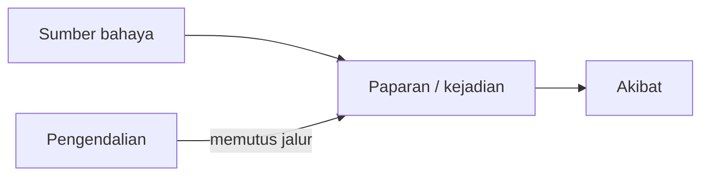

# Pertemuan 2 — Dari Mengenali Bahaya ke Merancang Kerja Aman

**Pendidikan Jasmani & HSE Geofisika · Sarjana Geofisika UGM**  
**Durasi: 90 menit · Format: penjelasan, demonstrasi ringan, simulasi keputusan.**

> Pertemuan 1: “Apa yang bisa mencederai kita?” Pertemuan 2: “Apa yang harus kita ubah sebelum pekerjaan dimulai?”

Materi ini merupakan usulan kelanjutan pertemuan pertama, bukan pengganti SOP laboratorium, manual instrumen, atau prosedur keselamatan kegiatan lapangan UGM.

## Capaian yang dapat diamati

Pada akhir kelas, mahasiswa mampu:

1. Membedakan bahaya, kejadian berbahaya, dan akibat pada sedikitnya 4 dari 5 contoh.
2. Memecah satu pekerjaan survei menjadi 4–6 langkah dan menyusun Job Safety Analysis (JSA).
3. Memilih pengendalian sesuai hierarki, termasuk sedikitnya satu perubahan desain kerja yang mengurangi ketergantungan pada kewaspadaan pekerja.
4. Memperagakan perencanaan pemindahan kotak alat ringan: memeriksa beban, jalur, pegangan, koordinasi, dan tempat peletakan.
5. Menyatakan keputusan lanjut/tunda/berhenti beserta syarat mulai kembali pada satu perubahan kondisi lapangan.

**Bukti belajar:** JSA kelompok, demonstrasi berpasangan, dan exit ticket individu. Kerapian laporan berbantuan AI tidak menggantikan penjelasan langsung.

## Alur 90 menit

| Menit | Kegiatan | Bukti belajar |
|---|---|---|
| 0–10 | Membahas foto alat dari tugas pertemuan 1 | Satu bahaya spesifik per mahasiswa |
| 10–25 | Bahaya → kejadian → akibat; hierarki pengendalian | Klasifikasi contoh |
| 25–40 | Contoh JSA pemindahan alat dan geolistrik | Alasan pemilihan kendali |
| 40–55 | Praktik gerak ringan dan pemindahan kotak | Checklist pengamatan pasangan |
| 55–75 | Kelompok menyusun JSA dan menerima kartu perubahan | Revisi keputusan di tempat |
| 75–85 | Toolbox talk dan verifikasi individu | Penjelasan tanpa AI |
| 85–90 | Exit ticket dan tugas lanjutan | Keputusan dan alasan tertulis |

## 1. Pembuka — “Alat ini sudah pernah kalian angkat?”

Minta dua mahasiswa menampilkan foto alat beserta kotaknya dari tugas sebelumnya. Jangan langsung menanyakan “berapa kilogram?”. Tanyakan:

- Adakah label berat, atau beratnya baru perkiraan?
- Siapa yang memindahkannya, dari mana, dan sejauh apa?
- Apakah ada tangga, lereng, kabel, atau tanah licin?
- Bisakah pekerjaan diubah agar alat tidak perlu dipanggul sejauh itu?

**Pesan:** angka berat belum cukup untuk menyimpulkan pekerjaan aman. Jarak beban dari tubuh, tinggi awal/akhir, pengulangan, pegangan, medan, dan kondisi orang ikut menentukan. Tidak ada satu batas kilogram universal untuk seluruh kegiatan lapangan. Persamaan angkat NIOSH juga memiliki lingkup penerapan; bukan kalkulator universal untuk membawa alat di lereng.

Data denyut istirahat atau hasil latihan pertemuan pertama boleh direfleksikan secara pribadi. Jangan diumumkan, dipakai merangking, atau dijadikan izin bekerja. Kebugaran membantu, tetapi tidak menggantikan pengendalian bahaya; istilah “APD internal” hanyalah analogi pembelajaran.

## 2. Bahaya bukan akibat

| Bahaya/sumber | Kejadian yang mungkin terjadi | Akibat |
|---|---|---|
| Kabel melintang jalur | Kaki tersangkut saat membawa kotak | Jatuh, cedera, alat rusak |
| Energi listrik saat injeksi | Seseorang menyentuh bagian berbahaya | Sengatan atau cedera serius |
| Kotak besar tanpa pegangan baik | Beban bergeser atau terlepas | Cedera otot, kaki tertimpa |
| Panas dan aktivitas fisik | Tubuh tidak mampu membuang panas dengan memadai | Gangguan kesehatan terkait panas |
| Lereng berkerikil | Pijakan kehilangan traksi | Tergelincir dan jatuh |

**Latihan 2 menit:** “Kurang hati-hati” bukan uraian bahaya yang memadai. Ganti dengan kondisi teramati, misalnya “operator tidak mempunyai konfirmasi bahwa seluruh anggota keluar dari zona elektroda”.

## 3. Mengapa APD bukan jawaban pertama

Hierarki membantu memilih perlindungan yang lebih sedikit bergantung pada tindakan sempurna setiap orang. Gunakan kombinasi bila diperlukan.

| Urutan | Pertanyaan praktis | Contoh pada survei |
|---|---|---|
| Eliminasi | Bisakah paparan dihilangkan? | Batalkan titik yang tidak mempunyai akses aman; evaluasi dampaknya pada desain survei |
| Substitusi | Bisakah cara/bahan diganti dengan yang lebih rendah bahayanya? | Pilih alat yang lebih ringan bila tetap memenuhi kebutuhan dan risiko barunya dinilai |
| Rekayasa | Bisakah manusia dipisahkan dari bahaya secara fisik? | Alat bantu angkut yang sesuai medan, pembatas zona, pelindung kabel |
| Administratif | Siapa melakukan apa, dengan syarat apa? | SOP, pembagian peran, komunikasi tertutup, jadwal kerja-istirahat |
| APD | Perlindungan pribadi apa yang sesuai? | Sepatu dan perlindungan lain berdasarkan penilaian bahaya serta SOP |

**Jangan berhenti pada “pakai sarung tangan”.** Sarung tangan umum bukan jaminan perlindungan listrik. Pengamanan energi, pengendalian akses, kompetensi operator, dan manual instrumen tetap menentukan.

Sumber konsep: [OSHA—Hazard Prevention and Control](https://www.osha.gov/safety-management/hazard-prevention).

## 4. JSA: rencana kerja yang bisa diperiksa

JSA menghubungkan **langkah → bahaya → kejadian → kendali → penanggung jawab → bukti verifikasi**. Tulis tindakan yang dapat diamati, bukan “hati-hati”, “fokus”, atau “gunakan APD”.

### Contoh: memindahkan alat menuju lintasan

| Langkah | Bahaya dan kejadian | Kendali sebelum bekerja | PIC dan verifikasi |
|---|---|---|---|
| Menentukan rute | Lereng licin; pembawa jatuh | Tinjau rute, pilih akses lebih aman; tunda bila akses tidak layak | Ketua tim menunjukkan rute dan titik istirahat |
| Menyiapkan alat | Berat/pegangan belum diketahui; beban terlepas | Periksa label/manual, kondisi kotak, isi lepas dan pegangan; pilih bantuan yang sesuai | Penanggung jawab alat memastikan kondisi dan metode angkut |
| Mengangkat dan membawa | Beban jauh dari tubuh, pandangan tertutup, kelelahan | Gunakan alat bantu bila sesuai; koordinasikan bantuan; jalur dan pandangan harus jelas | Pembawa melakukan pemeriksaan awal dan menyepakati aba-aba |
| Meletakkan alat | Jari terjepit, tanah tidak stabil | Siapkan tempat stabil, komunikasikan penurunan, jauhkan tangan dari titik jepit | Pemimpin pemindahan memberi aba-aba |
| Menyiapkan pengukuran | Orang masuk zona saat energi aktif | Terapkan prosedur pengamanan energi dan komunikasi sesuai instrumen/SOP | Operator memverifikasi persyaratan; tidak mulai jika konfirmasi gagal |

**Contoh geolistrik:** sebelum injeksi, seluruh syarat aman menurut SOP harus terpenuhi. Saat pemindahan atau penanganan elektroda, terapkan prosedur penghentian dan pengamanan energi sesuai manual, termasuk energi tersimpan bila relevan. Diamnya radio bukan konfirmasi aman. Materi kelas tidak mengizinkan praktik listrik aktif.

### Tentang matriks risiko

Skor kemungkinan × keparahan adalah alat bantu diskusi, bukan probabilitas kecelakaan yang terukur. Jika memakai matriks 5×5 dari pertemuan pertama, pakai definisi kategori yang sama dan tuliskan alasannya. Pengurangan skor residual harus didukung kendali yang sudah diverifikasi. Skor rendah tidak mengesahkan pelanggaran SOP atau bahaya fatal yang belum terkendali.

Sumber: [OSHA—Job Hazard Analysis](https://www.osha.gov/sites/default/files/activities_safety_in_5_jha.pdf).

## 5. Praktik jasmani dan ergonomi — 15 menit

**Tujuan:** melatih koordinasi, penilaian diri, dan perencanaan gerak; bukan lomba kekuatan atau tes ketahanan maksimal.

Gunakan kotak kosong atau benda sangat ringan, ruang datar, dan jalur bebas hambatan. Tidak memakai aki, palu seismik, atau perangkat berenergi. Mahasiswa dapat menjadi pengamat bila tidak nyaman atau membutuhkan penyesuaian. Hentikan aktivitas bila timbul keluhan.

1. **3 menit — kesiapan gerak:** berjalan santai di tempat dan gerakkan sendi dalam rentang nyaman. Jangan memaksakan peregangan atau menahan napas.
2. **4 menit — rencana sebelum menyentuh:** inspeksi kotak dan jalur, tentukan tujuan, pertimbangkan apakah perlu memindahkannya sama sekali.
3. **5 menit — simulasi berpasangan:** dekati kotak, gunakan pijakan stabil dan pegangan yang baik, dekatkan beban sesuai kenyamanan, bergerak terkendali; ubah arah dengan langkah, hindari memutar badan sambil menahan beban. Bergantian menjadi pengamat.
4. **3 menit — refleksi:** bagian mana yang membatasi: pegangan, pandangan, keseimbangan, atau koordinasi? Usulkan perubahan pekerjaan sebelum meminta orang “lebih kuat”.

Tidak ada satu teknik postur yang membuat semua beban aman. Alat bantu, desain tugas, dan pengurangan paparan tetap prioritas. Rujukan: [NIOSH—Ergonomic Controls](https://www.cdc.gov/niosh/ergonomics/ergo-programs/implement.html), [NIOSH—Lifting Equation](https://www.cdc.gov/niosh/ergonomics/about/rnle.html).

### Checklist pengamat (0/1 per butir)

- Memeriksa beban dan pegangan sebelum memindahkan.
- Memeriksa rute dan tempat peletakan.
- Memilih metode/bantuan berdasarkan kondisi, bukan gengsi.
- Menjaga pandangan, komunikasi, dan gerak terkendali.
- Menghentikan atau mengubah tindakan ketika kondisi tidak aman.

Target latihan: **minimal 4/5**, lalu ulangi butir yang belum tercapai. Ini indikator belajar, bukan sertifikasi layak mengangkat beban nyata.

## 6. Simulasi kelompok — keputusan yang berubah bersama kondisi

**Kelompok 3–4 orang.** Survei geolistrik di perbukitan, bentangan 400 m, akses berbatu, satu kotak alat dan kabel. Berat belum diverifikasi. Tim mengejar penyelesaian sebelum sore. Susun JSA 4–6 langkah.

Pada menit ke-10 diskusi, pengajar membagikan satu kartu:

| Kartu perubahan | Pertanyaan yang wajib dijawab |
|---|---|
| Radio tidak berfungsi | Tahap apa dihentikan? Apa syarat komunikasi sebelum mulai kembali? |
| Hujan membuat akses licin | Apakah rute masih layak? Siapa memeriksa ulang? |
| Satu anggota melaporkan kelelahan | Bagaimana tugas, bantuan, dan waktu istirahat diubah tanpa menyalahkan orangnya? |
| Pemilik lokasi menolak satu titik | Bagaimana akses dan desain survei disesuaikan tanpa memaksakan pekerjaan? |

Untuk kerja di panas, akses air, kesempatan istirahat, tempat sejuk/teduh, dan penyesuaian beban perlu direncanakan; jangan mengandalkan rasa haus atau kebugaran semata. Jadwalnya disesuaikan kondisi dan prosedur setempat, bukan satu angka untuk semua situasi. [OSHA—Water, Rest, Shade](https://www.osha.gov/heat-exposure/water-rest-shade).

Setiap kelompok menyebutkan **keputusan**, **alasan**, **PIC**, dan **syarat mulai kembali**. “Berhenti” tanpa rencana evaluasi ulang belum lengkap; “lanjut karena tinggal sedikit” bukan alasan keselamatan.

## 7. Toolbox talk 60 detik

> “Pekerjaan kita … Bahaya utama … Kendali yang sudah diperiksa … Pembagian peran … Cara konfirmasi … Kita berhenti bila … Titik kumpul dan cara meminta bantuan … Sebelum mulai, adakah kondisi yang belum aman?”

Pengajar mengubah satu kondisi setelah paparan, lalu meminta anggota yang dipilih acak menjelaskan akibatnya. Semua anggota harus memahami JSA, bukan hanya penulisnya.

## 8. Penilaian formatif

| Bukti | Bobot usulan | Kriteria |
|---|---:|---|
| JSA kelompok | 40% | Langkah spesifik 10; hubungan bahaya–kejadian–akibat 10; kendali relevan 10; PIC/verifikasi 10 |
| Demonstrasi/pengamatan individu | 30% | Checklist 5 butir, masing-masing 6 poin; peran pengamat dan penyesuaian aktivitas setara |
| Exit ticket individu | 30% | Tiga jawaban beralasan, masing-masing 10 poin |

AI boleh membantu draf JSA dan membandingkan opsi. Mahasiswa wajib memeriksa hasilnya dengan sumber/SOP; jangan memasukkan data kesehatan pribadi ke layanan AI. Verifikasi individu dilakukan langsung. Salah mengidentifikasi kendali keselamatan kritis harus dikoreksi dan diperagakan ulang, walaupun nilai totalnya tinggi.

**Exit ticket:** (1) Ubah “hati-hati mengangkat” menjadi kendali yang dapat diperiksa. (2) Mengapa sepatu dan sarung tangan tidak cukup untuk skenario geolistrik? (3) Sebut kondisi penghentian beserta syarat mulai kembali.

## 9. Tugas menuju pertemuan berikutnya

Gunakan foto alat dari pertemuan 1. Buat JSA satu halaman untuk pemindahannya: 4–6 langkah, kendali, PIC, verifikasi, serta kondisi penghentian. Tandai informasi yang belum diketahui—jangan mengarang berat atau kemampuan alat bantu. Sertakan satu perubahan desain kerja dan catatan penggunaan AI.

Tidak perlu mengangkat alat sungguhan, menjalankan instrumen, atau melakukan latihan maksimal untuk tugas ini.

**Kunci pengajar:** jawaban yang baik menyebut tindakan teramati dan kendali yang cocok dengan kejadian, bukan daftar APD. Pada kasus radio gagal, tahap yang bergantung pada konfirmasi keselamatan tidak dimulai/dilanjutkan sampai komunikasi dan syarat aman dipulihkan sesuai SOP.

## Referensi dan posisi materi

- [Pertemuan 1—halaman mata kuliah](https://maswiet.github.io/kuliah/pendidikan-jasmani-hse/#pertemuan-1): dasar kesinambungan, durasi, dan tugas observasi alat.
- OSHA dan NIOSH pada tautan di atas: acuan pembelajaran internasional, bukan klaim kepatuhan terhadap ketentuan Indonesia.
- SOP UGM, aturan lokasi, manual instrumen, dan pengarahan petugas kompeten: acuan operasional kegiatan nyata yang harus ditambahkan pengampu sebelum praktik lapangan.
